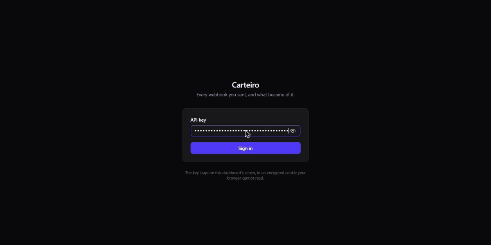
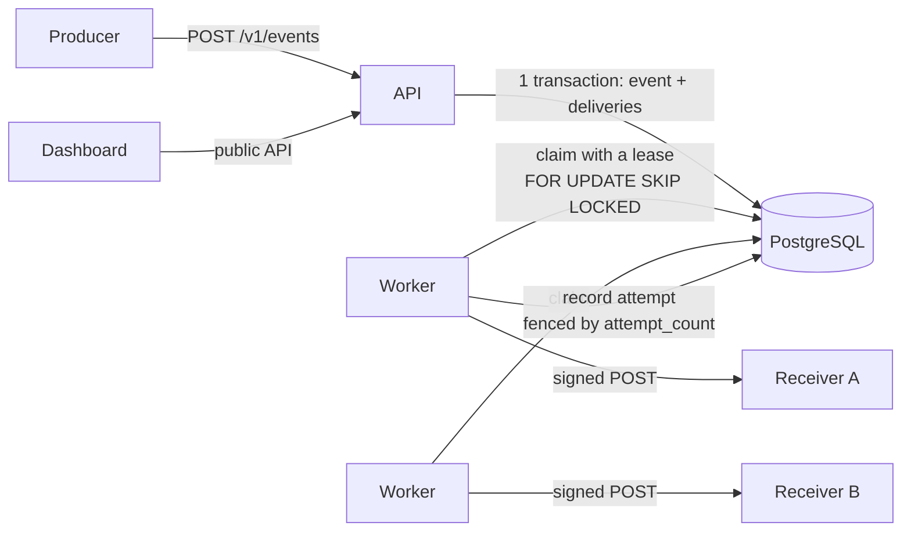

# Carteiro

> Reliable webhook delivery as a self-hostable service: signed, retried, observable.

[](https://github.com/joaomouravs/carteiro/actions/workflows/ci.yml)

Carteiro (Portuguese for *mail carrier*) takes webhook delivery off your application's
plate. You publish an event once; Carteiro fans it out to every subscribed endpoint,
signs it with the [Standard Webhooks](https://www.standardwebhooks.com/) spec, retries
with exponential backoff, disables endpoints that keep failing, and records every attempt
so you can inspect and replay what went wrong.



## Engineering highlights

- **PostgreSQL is the queue.** Workers claim deliveries with `FOR UPDATE SKIP LOCKED` and
  a short lease, then send with no transaction open; `attempt_count` is a fencing token,
  so a worker that lost its lease cannot overwrite a newer result
  ([ADR 0001](docs/adr/0001-postgres-as-queue.md), [ADR 0003](docs/adr/0003-lease-based-claiming.md)).
  A test claims 200 deliveries with 8 workers at once; without `SKIP LOCKED` it sees over
  200 duplicates.
- **Killing a worker loses nothing.** [`crash.sh`](loadtest/crash.sh) sends `SIGKILL` to
  a worker halfway through 20,000 deliveries: all of them arrive, and the ones it held
  come back when their lease expires.
- **Measured, then fixed.** Load testing showed throughput flipping between about 450 and
  1,400 deliveries/s for the same setup: a lock convoy on the endpoint row, held across
  every commit's fsync. [How it was found and fixed](docs/performance.md).
- **SSRF-safe by construction.** The guard runs in the dialer, on the address each
  connection is about to use, so DNS rebinding cannot bypass it; IPv4 hidden in IPv6
  (`::ffff:`, NAT64) is unwrapped first, and redirects are not followed.
- **Compatible, and proven so.** Deliveries follow Standard Webhooks; the example
  receiver's tests sign with Carteiro's code and verify with the official library, in CI.
- **The dashboard never hands the API key to the browser.** It is a separate Next.js app
  on the public API; the key stays on its server in an encrypted `httpOnly` cookie, and a
  build that imports the API client into a client component fails
  ([ADR 0007](docs/adr/0007-dashboard-as-a-separate-nextjs-app.md)).

## How it works



Publishing stores the event and one delivery per subscribed endpoint in one transaction,
so an accepted event can never be lost before it is queued. Workers can run anywhere,
any number of them, against the same database. More in [architecture](docs/architecture.md).

## Guarantees

- **At-least-once delivery.** An accepted event is never lost, even if a worker crashes
  mid-delivery. Receivers should deduplicate using the `webhook-id` header.
- **No ordering guarantee.** One failing event never blocks the others.
- **No transaction held across network calls.** Workers claim deliveries with short
  leases, so slow receivers cannot exhaust the database.

## Performance

Measured on a GitHub-hosted runner with the [Load test workflow](.github/workflows/loadtest.yml),
which anyone can run again ([method, all numbers, and the bottleneck](docs/performance.md)):

| | Result | Target |
|---|---|---|
| Delivery throughput, 4 workers | **1,549 deliveries/s** (was 938 before the lock convoy fix) | 500/s (NFR-PERF-02) |
| Ingest latency at 200 events/s | **p99 3.54 ms**, no errors in 12,001 requests | p99 < 50 ms (NFR-PERF-01) |
| Worker killed with `SIGKILL` mid-run | **every delivery arrives**; the ones it held come back after their lease (measured on the development laptop; the workflow now runs it too) | NFR-REL-01 |

## Running locally

Requirements: Docker. For development, also Go 1.27 and
[Task](https://taskfile.dev) (`go install github.com/go-task/task/v3/cmd/task@latest`).

Run the whole stack (PostgreSQL, migrations, API, worker, dashboard) with one command:

```sh
docker compose -f deploy/compose.yaml up --build
curl localhost:8080/readyz   # {"status":"ok"}
```

The [dashboard](dashboard/) is at http://localhost:3001: sign in with an application's API
key to follow events down to each HTTP attempt, replay failures, enable endpoints and
rotate their secrets. It is a separate Next.js app that uses only the public API, and the
key stays on its server in an encrypted, `httpOnly` cookie
([ADR 0007](docs/adr/0007-dashboard-as-a-separate-nextjs-app.md)). To work on it:
`cd dashboard && cp .env.example .env.local && npm ci && npm run dev`.

Development workflow:

```sh
cp .env.example .env
task run        # start PostgreSQL, apply migrations, run the API and the worker with go run
task test       # unit and integration tests (integration tests start PostgreSQL in Docker)
task test:unit  # only the fast tests
task test:race:docker  # all tests with the race detector, inside a Linux container
task lint       # golangci-lint
task sqlc       # regenerate Go code after changing a query or a migration
```

`sqlc` and `golangci-lint` run from their official Docker images, so they need no
installation and use the same versions as CI.

### Trying it end to end

[`examples/receiver`](examples/receiver/main.go) is a receiver that verifies webhooks
with the official Standard Webhooks library and deduplicates them by `webhook-id`. Its
tests sign with Carteiro's code and verify with that library, which is the proof that
the two agree. To watch a webhook travel through the stack:

```sh
docker compose -f deploy/compose.yaml up -d --build --wait
ADMIN=dev-admin-token-change-me-0123456789
APP=$(curl -s localhost:8080/v1/applications -H "Authorization: Bearer $ADMIN" --json '{"name":"Demo"}' | jq -r .id)
KEY=$(curl -s localhost:8080/v1/applications/$APP/api-keys -H "Authorization: Bearer $ADMIN" --json '{}' | jq -r .key)

# The receiver needs the endpoint's secret, so the endpoint comes first.
export RECEIVER_SECRET=$(curl -s localhost:8080/v1/endpoints -H "Authorization: Bearer $KEY" \
  --json '{"url":"http://receiver:9000/webhooks"}' | jq -r .secret)
docker compose -f deploy/compose.yaml --profile demo up -d --build --wait receiver

EVENT=$(curl -s localhost:8080/v1/events -H "Authorization: Bearer $KEY" \
  --json '{"event_type":"invoice.paid","payload":{"invoice":"in_42"}}' | jq -r .id)
docker compose -f deploy/compose.yaml logs receiver    # msg="webhook received" type=invoice.paid
curl -s localhost:8080/v1/events/$EVENT/deliveries -H "Authorization: Bearer $KEY"   # "status":"succeeded"
```

### Metrics and dashboard

Add `--profile observability` to run Prometheus and a Grafana dashboard provisioned from
[`deploy/grafana`](deploy/grafana/dashboards/carteiro.json):

```sh
docker compose -f deploy/compose.yaml --profile observability up -d --build --scale worker=2
# Grafana: http://localhost:3000 (anonymous, read-only)   Prometheus: http://localhost:9090
```

The panel to alert on is **oldest overdue delivery** (`carteiro_oldest_pending_age_seconds`):
how long the most overdue delivery has waited for a worker. It grows when workers fall
behind, well before anything fails. Prometheus finds every worker replica through DNS, so
scaling the worker needs no configuration change.

## Configuration

| Variable | Default | Description |
|---|---|---|
| `CARTEIRO_DATABASE_URL` | (required) | PostgreSQL connection string |
| `CARTEIRO_ADMIN_TOKEN` | (required) | Operator token, at least 32 characters (`openssl rand -hex 32`) |
| `CARTEIRO_ENCRYPTION_KEY` | (required) | Base64 of 32 bytes (`openssl rand -base64 32`); encrypts endpoint secrets |
| `CARTEIRO_ALLOW_HTTP_ENDPOINTS` | `false` | Accept `http://` endpoint URLs; development only |
| `CARTEIRO_ALLOW_PRIVATE_NETWORKS` | `false` | Let endpoints and deliveries reach loopback and private addresses (link-local and cloud metadata stay blocked); development only |
| `CARTEIRO_HTTP_ADDR` | `:8080` | Address the API listens on |
| `CARTEIRO_METRICS_ADDR` | `:9091` | Where every process serves `GET /metrics` for Prometheus; kept off the public API |
| `CARTEIRO_LOG_LEVEL` | `info` | `debug`, `info`, `warn` or `error` |
| `CARTEIRO_SHUTDOWN_TIMEOUT` | `15s` | Time in-flight requests get to finish on shutdown |
| `CARTEIRO_WORKER_CONCURRENCY` | `10` | Deliveries one worker sends at once (1 to 1000) |
| `CARTEIRO_DELIVERY_TIMEOUT` | `15s` | Limit for each delivery request; the lease is this plus 30s |
| `CARTEIRO_POLL_INTERVAL` | `1s` | How long an idle worker waits before checking the queue again |
| `CARTEIRO_RETRY_BASE` | `30s` | First retry delay ceiling; it doubles after each failure |
| `CARTEIRO_RETRY_CAP` | `6h` | Longest wait between two attempts |
| `CARTEIRO_MAX_ATTEMPTS` | `12` | Attempts before a delivery is marked `dead` (1 to 100) |
| `CARTEIRO_DISABLE_AFTER` | `120h` | An endpoint is disabled once it has failed for this long... |
| `CARTEIRO_DISABLE_MIN_FAILURES` | `10` | ...and at least this many times in a row; both must hold |
| `CARTEIRO_RETENTION` | `720h` | Events and attempts older than this are deleted, hourly, by the worker |
| `CARTEIRO_SECRET_GRACE_PERIOD` | `24h` | How long a rotated-out secret keeps signing deliveries, unless the request sets one |

## API

Errors use [RFC 9457 Problem Details](https://www.rfc-editor.org/rfc/rfc9457)
(`application/problem+json`), with a `request_id` matching the `X-Request-Id` header.
Lists are paginated with an opaque cursor: pass `next_cursor` back as `?cursor=`.

The operator creates an application and an API key with the admin token:

```sh
ADMIN=dev-admin-token-change-me-0123456789   # the development token from .env.example

curl -s localhost:8080/v1/applications -H "Authorization: Bearer $ADMIN"   -H 'Content-Type: application/json' -d '{"name":"Acme"}'
# {"id":"019a...","name":"Acme","created_at":"..."}

curl -s localhost:8080/v1/applications/<id>/api-keys -H "Authorization: Bearer $ADMIN"   -H 'Content-Type: application/json' -d '{"name":"production"}'
# {"id":"...","prefix":"crt_AbCdEfGh","key":"crt_AbCdEfGh...", ...}   <- shown only once
```

The producer then authenticates with the API key:

```sh
KEY=crt_...
curl -s localhost:8080/v1/me -H "Authorization: Bearer $KEY"

curl -s localhost:8080/v1/endpoints -H "Authorization: Bearer $KEY"   -H 'Content-Type: application/json'   -d '{"url":"https://example.com/webhooks","event_types":["invoice.paid"]}'
# {"id":"...","url":"https://example.com/webhooks", ..., "secret":"whsec_..."}   <- shown only once
```

Publishing an event queues one delivery for every active endpoint subscribed to its type,
in the same transaction:

```sh
curl -s localhost:8080/v1/events -H "Authorization: Bearer $KEY"   -H 'Content-Type: application/json' -H 'Idempotency-Key: invoice-in_1-paid'   -d '{"event_type":"invoice.paid","payload":{"invoice":"in_1","amount":1999}}'
# 202 {"id":"...","event_type":"invoice.paid","payload":{...},"idempotency_key":"invoice-in_1-paid",...}
```

Repeating a request with the same `Idempotency-Key` returns the original event with `200`
and `Idempotent-Replayed: true`; reusing the key with a different payload returns `409`.
Payloads are compared as JSON values, so key order and whitespace do not matter
([ADR 0006](docs/adr/0006-idempotency-compares-normalized-json.md)).

To see what happened to an event, follow it down to each HTTP attempt:

```sh
curl -s localhost:8080/v1/events/<event id>/deliveries -H "Authorization: Bearer $KEY"
# {"data":[{"id":"...","endpoint_id":"...","status":"pending","attempt_count":1,"next_attempt_at":"..."}],"next_cursor":null}

curl -s localhost:8080/v1/deliveries/<delivery id>/attempts -H "Authorization: Bearer $KEY"
# {"data":[{"attempt_number":1,"response_status":503,"response_body":"try later","error":null,"duration_ms":120,...}],...}
```

The receiver uses the `whsec_` secret to verify signatures. Carteiro stores it encrypted
with AES-256-GCM, bound to its endpoint, under `CARTEIRO_ENCRYPTION_KEY`.

| Method and path | Auth | Description |
|---|---|---|
| `POST /v1/applications` | admin | Create an application |
| `GET /v1/applications` | admin | List applications, newest first (paginated) |
| `GET /v1/applications/{id}` | admin | Get an application |
| `POST /v1/applications/{id}/api-keys` | admin | Issue an API key (returned once) |
| `GET /v1/applications/{id}/api-keys` | admin | List an application's keys (prefix only) |
| `DELETE /v1/applications/{id}/api-keys/{key_id}` | admin | Revoke a key (idempotent) |
| `GET /v1/me` | API key | The application the key belongs to |
| `POST /v1/endpoints` | API key | Create an endpoint; returns its signing secret once |
| `GET /v1/endpoints` | API key | List endpoints, newest first (paginated) |
| `GET /v1/endpoints/{id}` | API key | Get an endpoint |
| `PATCH /v1/endpoints/{id}` | API key | Change `url`, `description` or `event_types`; omitted fields keep their value |
| `DELETE /v1/endpoints/{id}` | API key | Delete an endpoint and its delivery history |
| `POST /v1/endpoints/{id}/enable` | API key | Re-enable a disabled endpoint, with a clean failure record |
| `POST /v1/endpoints/{id}/rotate-secret` | API key | New signing secret, returned once; the old one stays valid for the grace period, or `{"grace_period_seconds": 0}` revokes it at once |
| `POST /v1/endpoints/{id}/replay` | API key | Replay every `dead` delivery created since `{"since": "<RFC 3339>"}`; returns `{"replayed": n}` |
| `POST /v1/events` | API key | Publish an event (payload up to 256 KiB); optional `Idempotency-Key` |
| `GET /v1/events` | API key | List events, newest first (paginated); optional `?event_type=` |
| `GET /v1/events/{id}` | API key | Get an event |
| `GET /v1/events/{id}/deliveries` | API key | The event's deliveries, one per endpoint it was sent to (paginated) |
| `GET /v1/deliveries/{id}` | API key | Get a delivery: `status` (`pending`, `in_flight`, `succeeded`, `dead`), `attempt_count`, `next_attempt_at` |
| `GET /v1/deliveries/{id}/attempts` | API key | Every HTTP attempt, newest first: status, first 4 KiB of the response body, error, duration (paginated) |
| `POST /v1/deliveries/{id}/replay` | API key | Send a `dead` or `succeeded` delivery again, with a fresh retry schedule |

## Documentation

- [Requirements](docs/requirements.md)
- [Architecture](docs/architecture.md)
- Architecture decision records
  - [0001: PostgreSQL as the delivery queue](docs/adr/0001-postgres-as-queue.md)
  - [0002: Standard Webhooks signing](docs/adr/0002-standard-webhooks-signing.md)
  - [0003: Lease-based claiming](docs/adr/0003-lease-based-claiming.md)
  - [0004: At-least-once delivery, without ordering](docs/adr/0004-at-least-once-delivery.md)
  - [0005: Go with minimal dependencies](docs/adr/0005-go-with-minimal-dependencies.md)
  - [0006: Idempotency compares normalized JSON](docs/adr/0006-idempotency-compares-normalized-json.md)
  - [0007: The dashboard is a separate Next.js app on the public API](docs/adr/0007-dashboard-as-a-separate-nextjs-app.md)
- [Performance](docs/performance.md): how it is load tested, and what limits it

## License

[MIT](LICENSE)
