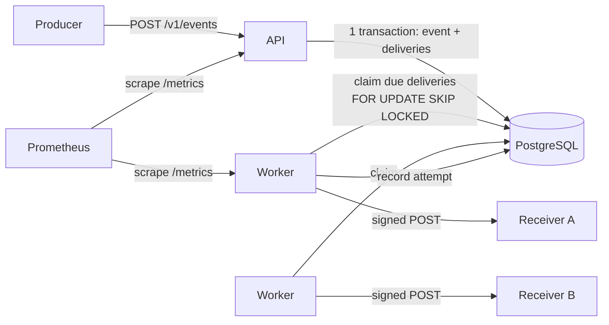
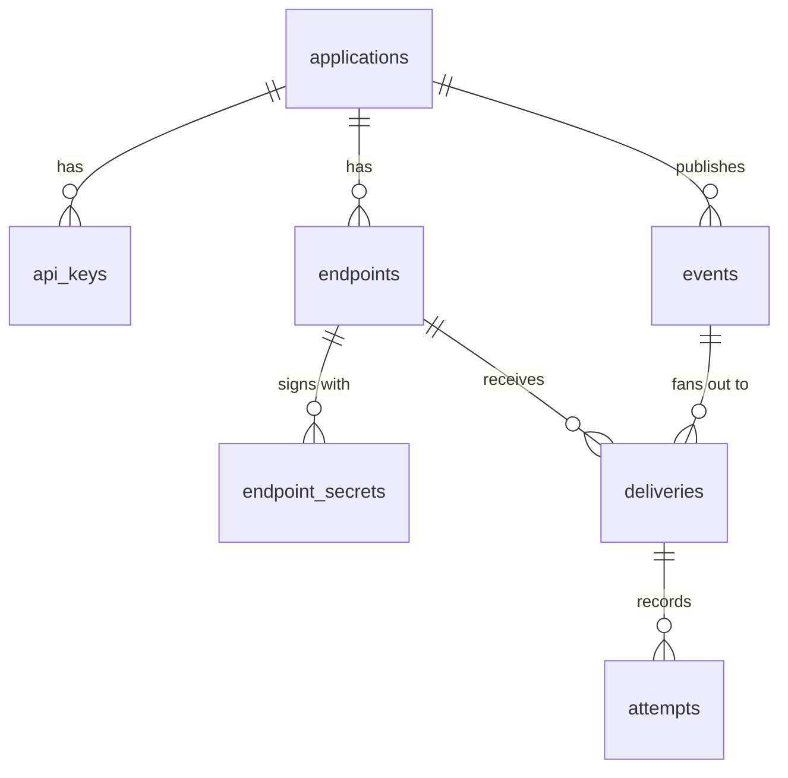
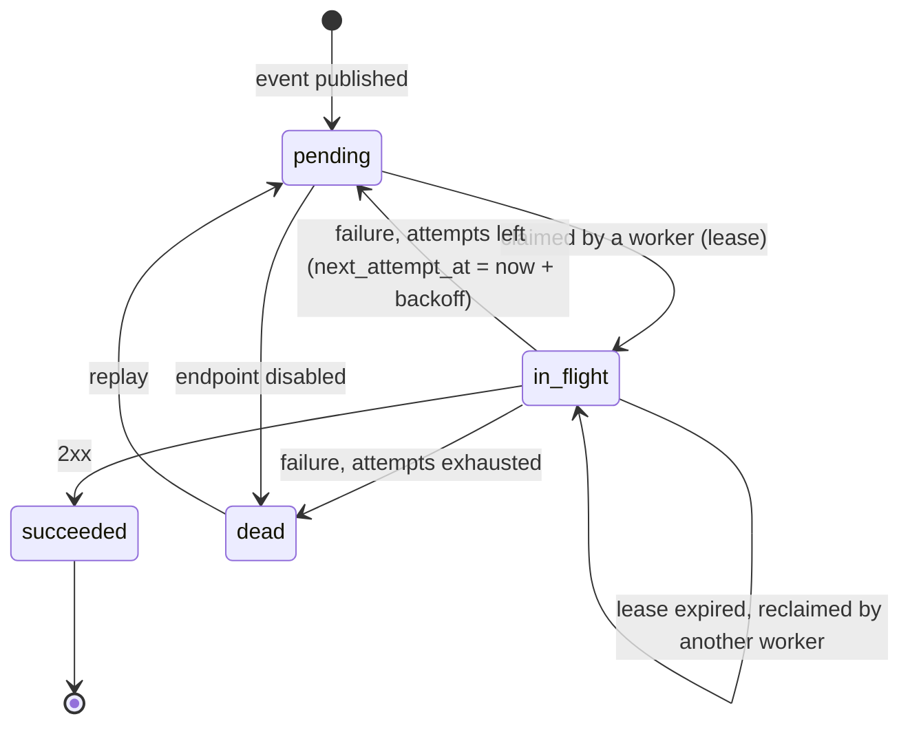

# Architecture

## Overview

Carteiro is a single Go binary with two roles, which can run in the same process or in
separate processes:

- **API**: authenticates producers, manages endpoints, and accepts events.
- **Worker**: claims due deliveries from PostgreSQL, sends them, and records the outcome.

PostgreSQL is the only stateful dependency. It stores the data *and* acts as the queue
([ADR 0001](adr/0001-postgres-as-queue.md)).



```
cmd/carteiro/          entrypoint: `serve`, `work`, `all`, `migrate`
internal/
  api/                 HTTP handlers, auth middleware, problem+json errors
  delivery/            worker loop, claiming, HTTP sender, backoff
  signing/             Standard Webhooks signing and verification
  netguard/            SSRF-safe dialer
  retention/           hourly purge of data past the retention period
  crypto/              AES-GCM for secrets at rest, API key generation and hashing
  store/               generated sqlc code + hand-written repository methods
  config/              environment configuration
migrations/            SQL migrations (embedded in the binary)
dashboard/             Next.js dashboard on the public API (ADR 0007)
examples/receiver/     sample receiver verifying signatures with the official library
deploy/                docker compose, Prometheus and Grafana config
loadtest/              throughput and k6 ingest scripts (docs/performance.md)
```

## Data model



| Table | Key columns | Notes |
|---|---|---|
| `applications` | `id`, `name` | Tenant boundary. Every other row belongs to one. |
| `api_keys` | `prefix`, `hash`, `revoked_at` | `prefix` is shown in listings so a key can be identified without revealing it. |
| `endpoints` | `url`, `event_types text[]`, `status`, `consecutive_failures`, `failing_since` | `status` is `active` or `disabled`. |
| `endpoint_secrets` | `secret_ciphertext`, `expires_at` | Several rows during rotation; `expires_at` is null for the current secret. |
| `events` | `event_type`, `payload jsonb`, `idempotency_key`, `payload_hash` | `UNIQUE (application_id, idempotency_key)`. IDs are UUIDv7 so they sort by time. |
| `deliveries` | `status`, `attempt_count`, `next_attempt_at`, `lease_expires_at`, `replayed_at_attempt` | `UNIQUE (event_id, endpoint_id)`. This table is the queue. A replay restarts the retry schedule from `replayed_at_attempt`, since `attempt_count` is the fencing token and never goes back. |
| `attempts` | `attempt_number`, `response_status`, `duration_ms`, `response_body`, `error` | Append-only log. |

Two partial indexes keep the queue queries cheap no matter how much history accumulates:

```sql
CREATE INDEX deliveries_due     ON deliveries (next_attempt_at)  WHERE status = 'pending';
CREATE INDEX deliveries_leased  ON deliveries (lease_expires_at) WHERE status = 'in_flight';
```

## Delivery lifecycle



### Claiming work

A worker claims a batch of due deliveries and marks them as leased in one short
statement ([ADR 0003](adr/0003-lease-based-claiming.md)):

```sql
WITH due AS (
    SELECT id FROM deliveries
    WHERE status = 'pending' AND next_attempt_at <= now()
    ORDER BY next_attempt_at
    LIMIT $1
    FOR UPDATE SKIP LOCKED
)
UPDATE deliveries d
SET status = 'in_flight',
    lease_expires_at = now() + $2::interval,
    attempt_count = d.attempt_count + 1
FROM due
WHERE d.id = due.id
RETURNING d.*;
```

The transaction commits immediately, *before* any HTTP call. A second, equivalent query
reclaims rows whose lease expired (`status = 'in_flight' AND lease_expires_at <= now()`),
which is how deliveries survive a worker crash.

### Recording the result

The outcome is written with `attempt_count` as a **fencing token**:

```sql
UPDATE deliveries SET status = $3, next_attempt_at = $4, lease_expires_at = NULL
WHERE id = $1 AND attempt_count = $2 AND status = 'in_flight';
```

If a slow worker finishes after its lease expired and another worker already reclaimed
the row, `attempt_count` no longer matches, the update affects zero rows, and the stale
result is discarded (its attempt is still logged). The receiver may have received the
event twice; that is the at-least-once contract ([ADR 0004](adr/0004-at-least-once-delivery.md)).

### Retry schedule

`delay(n) = min(cap, base × 2^(n-1))`, then *equal jitter*: the actual delay is a random
value in `[delay/2, delay]`. Jitter spreads retries out so that an endpoint recovering
from an outage is not hit by every queued delivery at the same instant; keeping the lower
half fixed guarantees a minimum wait.

Defaults: `base = 30s`, `cap = 6h`, `max_attempts = 12`. The 11 waits between the 12
attempts add up to at most 14h31m30s, and jitter can halve each one, so a delivery is
retried for between about 7 and 14.5 hours before it is marked `dead`: long enough to
ride out an overnight outage. `Retry-After` on a `429` or `503` is a lower bound for the
next wait (the receiver asked not to be called sooner), capped at `cap` (FR-14).

### Endpoint health

The transaction that records an attempt also updates the endpoint's failure streak:
`consecutive_failures` and `failing_since`, both reset by any success. An endpoint is
disabled (FR-08) when the streak reaches **both** 10 failures and 5 days: a busy
endpoint fails ten times in a minute of downtime, and a quiet one can go days between
two failures, so either condition alone would disable healthy endpoints. A `410 Gone`
disables it at once, since the receiver said the URL is not coming back.

Disabling kills the endpoint's pending deliveries (`pending → dead`), and claims skip
disabled endpoints. After fixing the receiver, the producer enables the endpoint again
(FR-09) and replays what died in the meantime (FR-18). Failures on Carteiro's side, such
as a secret that no longer decrypts, are logged as attempts but do not count against the
endpoint.

### Retention

Every worker process purges hourly what is older than `CARTEIRO_RETENTION` (FR-21):
events, whose deliveries and attempts go with them by `ON DELETE CASCADE`; old attempts of
events that are kept; and secrets past their rotation grace period. An event with a
delivery still pending or in flight is kept, so retention never cancels work. Deletes run
in batches of 1,000, each its own short transaction, instead of one statement that would
hold locks and write WAL for minutes on a large table. A session-level advisory lock lets
one process purge at a time; the others skip the round, and PostgreSQL releases the lock
if its holder dies.

## Signing

Deliveries follow the [Standard Webhooks](https://www.standardwebhooks.com/) spec
([ADR 0002](adr/0002-standard-webhooks-signing.md)):

```
webhook-id:        <event id>
webhook-timestamp: <unix seconds>
webhook-signature: v1,<base64(HMAC-SHA256(secret, id + "." + timestamp + "." + body))>
```

During a rotation grace period, `webhook-signature` carries one signature per valid
secret, separated by spaces, so receivers can switch secrets without downtime.

Rotating (FR-06) sets every still-valid secret to expire at the end of the grace period,
keeping any earlier expiry, and inserts the new current one. The rotation first locks the
endpoint row, so concurrent rotations of one endpoint run one at a time: otherwise two
would retire the same current secret and both insert a new one, which the
one-current-secret index rejects. A grace period of zero revokes the old secrets at once,
for a secret that leaked.

## Outbound network safety

Receivers are URLs chosen by producers, so the worker must not become a way to reach
internal services (SSRF). The HTTP client uses a custom `net.Dialer` whose `Control`
hook inspects the **resolved IP at connect time** and refuses blocked ranges. Validating
only the hostname at endpoint creation is not enough: DNS can answer with a public IP
during validation and a private one during delivery (DNS rebinding).

Blocked by default: `127.0.0.0/8`, `::1`, `10.0.0.0/8`, `172.16.0.0/12`,
`192.168.0.0/16`, `169.254.0.0/16`, `fe80::/10`, `fc00::/7`, `100.64.0.0/10`,
`0.0.0.0/8`, `::`, multicast, and `255.255.255.255`. IPv6 addresses that embed an IPv4
address (IPv4-mapped `::ffff:a.b.c.d` and NAT64 `64:ff9b::/96`) are judged by the IPv4
address inside them, so an internal address cannot sneak through in IPv6 form.

The client also ignores `HTTP_PROXY` and friends, because through a proxy the dialer
would check the proxy's address instead of the receiver's, and it does not follow
redirects (NFR-SEC-04), because a public receiver could redirect to an internal URL.
Endpoint creation resolves the host and rejects it if any of its addresses is blocked
(FR-07); that check only gives an early error, and the dialer remains the guard. A host
that does not resolve yet is accepted, because receivers are often deployed after their
endpoint is created: they need the secret that creating it returns.

`CARTEIRO_ALLOW_PRIVATE_NETWORKS` (development only) opens loopback and the private
ranges (`10.0.0.0/8`, `172.16.0.0/12`, `192.168.0.0/16`, `fc00::/7`) so receivers on
localhost or in the compose network work. Link-local stays blocked even then: no
receiver lives there, and it holds the cloud metadata service.

## Observability

- Structured JSON logs with `log/slog`, with `event_id`, `delivery_id`, and `endpoint_id`
  on every delivery log line.
- Prometheus metrics, served by every process on `CARTEIRO_METRICS_ADDR` rather than on
  the public API (FR-20):
  - `carteiro_deliveries_total{outcome}`: `succeeded`, `retry`, `dead`, or `stale` when
    a lost lease discarded the result.
  - `carteiro_delivery_duration_seconds`: a histogram of attempt durations.
  - `carteiro_queue_depth{status}`: `pending` and `in_flight`, read from the database at
    each scrape by worker processes.
  - `carteiro_oldest_pending_age_seconds`, the most useful alert signal, because it shows
    workers falling behind before anything fails. It counts from when the most overdue
    delivery became due, not from when it was created: a delivery waiting out its backoff
    is on schedule.
  A failed database query fails the scrape instead of reporting an empty queue, so an
  outage cannot look like a healthy graph.
- A Grafana dashboard in `deploy/grafana`, provisioned by `docker compose --profile
  observability`. Prometheus discovers worker replicas through DNS.

## Testing strategy

| Level | What | How |
|---|---|---|
| Unit | Backoff, signing (against the official library's test vector), SSRF IP checks, idempotency conflict logic | `go test`, table-driven |
| Integration | Repository queries, claiming, fencing, migrations | Real PostgreSQL via Testcontainers |
| End-to-end | Publish → deliver → verify signature; receiver that fails N times then recovers | Carteiro in-process + `httptest` receiver |
| Concurrency | N workers draining the queue: every delivery succeeds, no row is claimed twice concurrently | Integration test with the race detector |
| Fault injection | Worker killed mid-delivery: the lease expires and the delivery still completes | Integration test |
| Load | Throughput and latency, published in the README | k6 |
