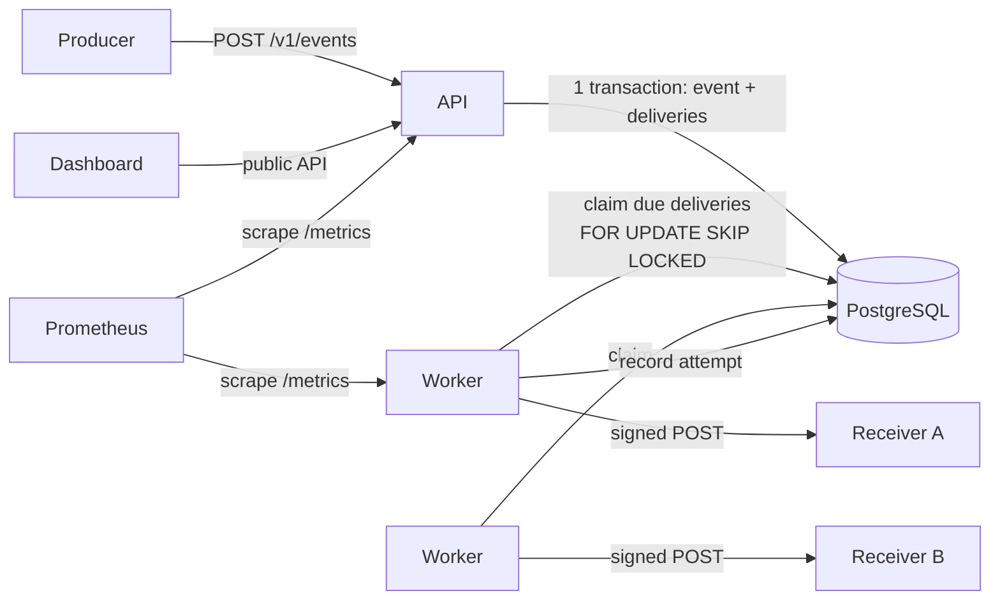
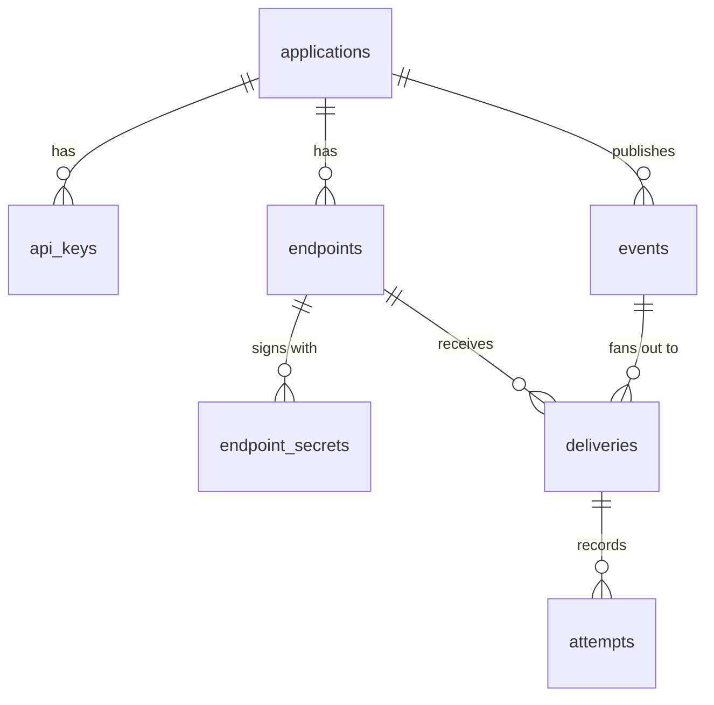
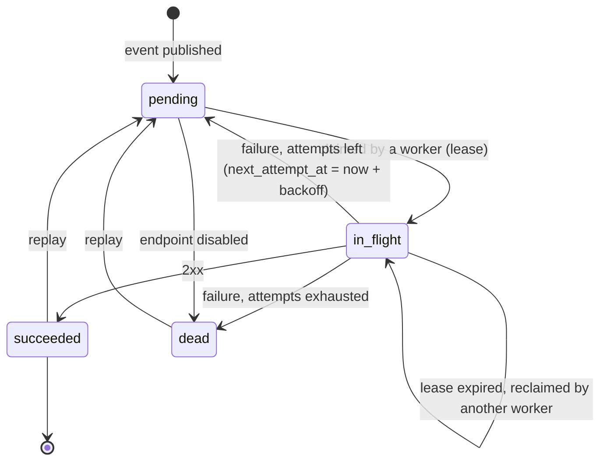

# Architecture

## Overview

Carteiro is one Go binary that can play two roles, in the same process or in separate
ones:

- **API**: authenticates producers, manages their endpoints and accepts events.
- **Worker**: claims due deliveries from PostgreSQL, sends them and records what happened.

PostgreSQL is the only thing with state. It stores the data *and* is the queue
([ADR 0001](adr/0001-postgres-as-queue.md)). The dashboard is a separate Next.js app that
only talks to the API ([ADR 0007](adr/0007-dashboard-as-a-separate-nextjs-app.md)).



```
cmd/carteiro/          entrypoint: `serve`, `work`, `all`, `migrate`
internal/
  api/                 HTTP handlers, auth middleware, problem+json errors
  delivery/            worker loop, claiming, HTTP sender, backoff
  signing/             Standard Webhooks signing and verification
  netguard/            SSRF-safe dialer and HTTP client
  retention/           hourly purge of data past the retention period
  metrics/             Prometheus metrics
  crypto/              AES-GCM for secrets at rest, API key generation and hashing
  store/               SQL queries (sqlc), the code sqlc generates, migrations, transactions
  config/              configuration from environment variables
migrations/            SQL migrations, embedded in the binary
dashboard/             Next.js dashboard on the public API (ADR 0007)
examples/receiver/     sample receiver that verifies signatures with the official library
deploy/                docker compose, Prometheus and Grafana config
loadtest/              throughput, crash and k6 ingest scripts (docs/performance.md)
```

## Data model



| Table | Key columns | Notes |
|---|---|---|
| `applications` | `id`, `name` | The tenant boundary. Every other row belongs to one. |
| `api_keys` | `prefix`, `hash`, `revoked_at` | Listings show `prefix`, so you can tell keys apart without seeing them. |
| `endpoints` | `url`, `event_types text[]`, `status`, `consecutive_failures`, `failing_since` | `status` is `active` or `disabled`. |
| `endpoint_secrets` | `secret_ciphertext`, `expires_at` | Several rows during a rotation; `expires_at` is null for the current secret. |
| `events` | `event_type`, `payload jsonb`, `idempotency_key`, `payload_hash` | `UNIQUE (application_id, idempotency_key)`. Ids are UUIDv7, so they sort by time. |
| `deliveries` | `status`, `attempt_count`, `next_attempt_at`, `lease_expires_at`, `replayed_at_attempt` | `UNIQUE (event_id, endpoint_id)`. This table is the queue. A replay restarts the retry schedule from `replayed_at_attempt`, because `attempt_count` is the fencing token and can never go back. |
| `attempts` | `attempt_number`, `response_status`, `duration_ms`, `response_body`, `error` | Append-only log. |

Two partial indexes keep the queue queries cheap no matter how much history piles up:

```sql
CREATE INDEX deliveries_due     ON deliveries (next_attempt_at)  WHERE status = 'pending';
CREATE INDEX deliveries_leased  ON deliveries (lease_expires_at) WHERE status = 'in_flight';
```

## Delivery lifecycle



### Claiming work

A worker claims due deliveries and leases them in one short statement
([ADR 0003](adr/0003-lease-based-claiming.md)):

```sql
WITH due AS (
    SELECT id FROM deliveries
    WHERE status = 'pending' AND next_attempt_at <= now()
      AND EXISTS (SELECT 1 FROM endpoints e WHERE e.id = deliveries.endpoint_id AND e.status = 'active')
    ORDER BY next_attempt_at
    LIMIT $1
    FOR UPDATE SKIP LOCKED
)
UPDATE deliveries d
SET status           = 'in_flight',
    lease_expires_at = now() + $2 * interval '1 millisecond',
    attempt_count    = d.attempt_count + 1
FROM due
WHERE d.id = due.id
RETURNING d.id, d.attempt_count;
```

It commits right away, *before* any HTTP call. A second query of the same shape picks up
rows whose lease expired (`status = 'in_flight' AND lease_expires_at <= now()`), and that
is how deliveries survive a worker crash. A worker only claims as many deliveries as it
has free slots, so nothing it claims sits in memory while its lease runs out.

Every time in these queries comes from the database's `now()`, never from a worker's
clock, so workers on different machines agree on what "due" and "expired" mean even if
their clocks drift.

### Recording the result

The outcome is written with `attempt_count` as a **fencing token**:

```sql
UPDATE deliveries
SET status = $3, next_attempt_at = now() + $4 * interval '1 millisecond', lease_expires_at = NULL
WHERE id = $1 AND attempt_count = $2 AND status = 'in_flight';
```

If a slow worker finishes after its lease expired and another worker already took the row,
`attempt_count` no longer matches, the update changes nothing, and the late result is
dropped (its attempt still goes in the log). The receiver may have gotten the event twice;
that is the at-least-once contract ([ADR 0004](adr/0004-at-least-once-delivery.md)).

### Retry schedule

`delay(n) = min(cap, base × 2^(n-1))`, then *equal jitter*: the real wait is a random value
in `[delay/2, delay]`. Jitter spreads retries out, so an endpoint coming back from an
outage is not hit by every queued delivery in the same second. Keeping the lower half fixed
guarantees a minimum wait.

The defaults are `base = 30s`, `cap = 6h` and `max_attempts = 12`. The 11 waits between the
12 attempts add up to at most 14h31m30s, and jitter can halve each one, so a delivery is
retried for somewhere between 7 and 14.5 hours before it is marked `dead`: enough to get
through an overnight outage. `Retry-After` on a `429` or `503` is a lower bound for the next
wait (the receiver asked not to be called sooner), capped at `cap` (FR-14).

### Endpoint health

The transaction that records an attempt also keeps track of the endpoint's failure streak,
`consecutive_failures` and `failing_since`, which any success resets. An endpoint is
disabled (FR-08) when the streak reaches **both** 10 failures and 5 days. I need both: a
busy endpoint fails ten times in one minute of downtime, and a quiet one can go days
between two failures, so either rule on its own would disable healthy endpoints. A
`410 Gone` disables it right away, since the receiver said that URL is not coming back.

A success to a healthy endpoint does not touch its row at all. It used to, and under load
that row became a lock convoy that capped throughput; [performance](performance.md) has the
story.

Disabling an endpoint kills its pending deliveries (`pending → dead`), and claims skip
disabled endpoints. After fixing the receiver, the producer enables the endpoint again
(FR-09) and replays what died in the meantime (FR-18). Failures on Carteiro's side, like a
secret that no longer decrypts, still go in the attempt log but do not count against the
endpoint.

### Retention

Every worker process purges, once an hour, what is older than `CARTEIRO_RETENTION`
(FR-21): events, which take their deliveries and attempts with them through
`ON DELETE CASCADE`; old attempts of events that are kept; and secrets past their rotation
grace period. An event with a delivery still pending or in flight is never purged, so
retention never cancels work. The deletes run in batches of 1,000, each its own short
transaction, instead of one statement that would hold locks and write WAL for minutes on a
big table. A session-level advisory lock lets one process purge at a time; the others skip
the round, and PostgreSQL releases the lock if the process holding it dies.

## Signing

Deliveries follow the [Standard Webhooks](https://www.standardwebhooks.com/) spec
([ADR 0002](adr/0002-standard-webhooks-signing.md)):

```
webhook-id:        <event id>
webhook-timestamp: <unix seconds>
webhook-signature: v1,<base64(HMAC-SHA256(secret, id + "." + timestamp + "." + body))>
```

During a rotation's grace period, `webhook-signature` carries one signature per valid
secret, separated by spaces, so receivers can switch secrets without downtime.

Rotating (FR-06) sets every secret that is still valid to expire at the end of the grace
period, keeping an earlier expiry if it already has one, and inserts the new current
secret. The rotation locks the endpoint row first, so two rotations of the same endpoint
run one after the other. Without that, both would retire the same current secret and both
would insert a new one, which the one-current-secret index rejects. A grace period of zero
revokes the old secrets at once, for when a secret leaked.

## Outbound network safety

Endpoint URLs are chosen by producers, so the worker must not become a way into internal
services (SSRF). The HTTP client uses a custom `net.Dialer` whose `Control` hook looks at
the **resolved IP at connect time** and refuses blocked ranges. Checking the hostname when
the endpoint is created is not enough: DNS can answer with a public IP then and a private
one when the delivery goes out (DNS rebinding).

Blocked by default: `127.0.0.0/8`, `::1`, `10.0.0.0/8`, `172.16.0.0/12`,
`192.168.0.0/16`, `169.254.0.0/16`, `fe80::/10`, `fc00::/7`, `100.64.0.0/10`,
`0.0.0.0/8`, `::`, multicast and `255.255.255.255`. IPv6 addresses that carry an IPv4
address inside (IPv4-mapped `::ffff:a.b.c.d` and NAT64 `64:ff9b::/96`) are judged by that
IPv4 address, so an internal address cannot sneak in written as IPv6.

The client also ignores `HTTP_PROXY` and similar variables, because through a proxy the
dialer would check the proxy's address instead of the receiver's. It does not follow
redirects (NFR-SEC-04), because a public receiver could redirect to an internal URL.
Creating or editing an endpoint resolves the host and rejects it if any of its addresses is
blocked (FR-07). That check is only there to give an early error; the dialer is the real
guard. A host that does not resolve yet is accepted, because receivers are often deployed
after their endpoint exists: they need the secret that creating it returns.

`CARTEIRO_ALLOW_PRIVATE_NETWORKS` (for development only) opens loopback and the private
ranges (`10.0.0.0/8`, `172.16.0.0/12`, `192.168.0.0/16`, `fc00::/7`), so receivers on
localhost or in the compose network work. Link-local stays blocked even then: no receiver
lives there, and it is where the cloud metadata service is.

## Observability

- Structured JSON logs with `log/slog`, with `event_id`, `delivery_id` and `endpoint_id`
  on every delivery log line.
- Prometheus metrics, served by every process on `CARTEIRO_METRICS_ADDR` instead of on the
  public API (FR-20):
  - `carteiro_deliveries_total{outcome}`: `succeeded`, `retry`, `dead`, or `stale` when a
    lost lease threw the result away.
  - `carteiro_delivery_duration_seconds`: a histogram of attempt durations.
  - `carteiro_queue_depth{status}`: `pending` and `in_flight`, read from the database at
    each scrape, by worker processes only.
  - `carteiro_oldest_pending_age_seconds`, the one I would alert on, because it shows
    workers falling behind before anything fails. It counts from when the most overdue
    delivery became due, not from when it was created: a delivery waiting out its backoff
    is on schedule.

  If the database query fails, the scrape fails, instead of reporting an empty queue. An
  outage should not look like a healthy graph.
- A Grafana dashboard in `deploy/grafana`, set up by `docker compose --profile
  observability`. Prometheus finds worker replicas through DNS.

## Testing strategy

| Level | What | How |
|---|---|---|
| Unit | Backoff, signing (against the official library's test vector), SSRF IP checks, idempotency logic, dashboard session sealing | `go test` and `node --test`, table-driven |
| Integration | Queries, claiming, fencing, migrations, every API route | A real PostgreSQL through Testcontainers |
| End-to-end | Publish → deliver → verify the signature; a receiver that fails twice and then recovers | Carteiro in-process with an `httptest` receiver |
| Concurrency | Workers draining one queue: every delivery succeeds and no row is claimed twice at once | Integration tests with the race detector |
| Fault injection | A worker killed mid-delivery: the lease expires and the delivery still completes | An integration test (lease expired by hand), and `loadtest/crash.sh`, which kills a real worker with `SIGKILL` |
| Load | Throughput and latency, published in [performance](performance.md) | `loadtest/` scripts and k6, in a GitHub Actions workflow |
