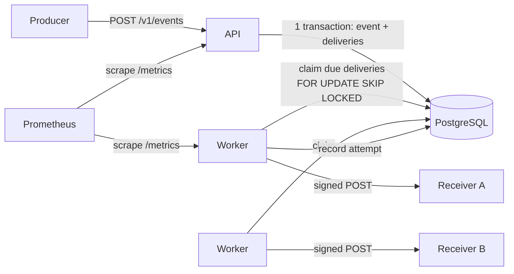
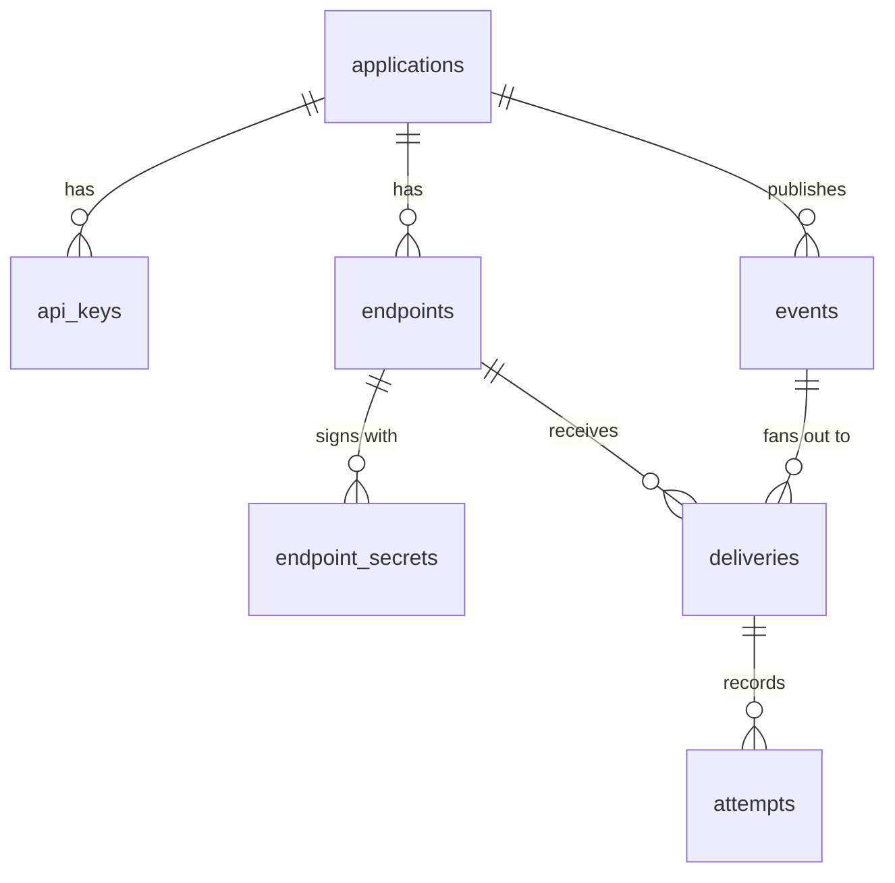
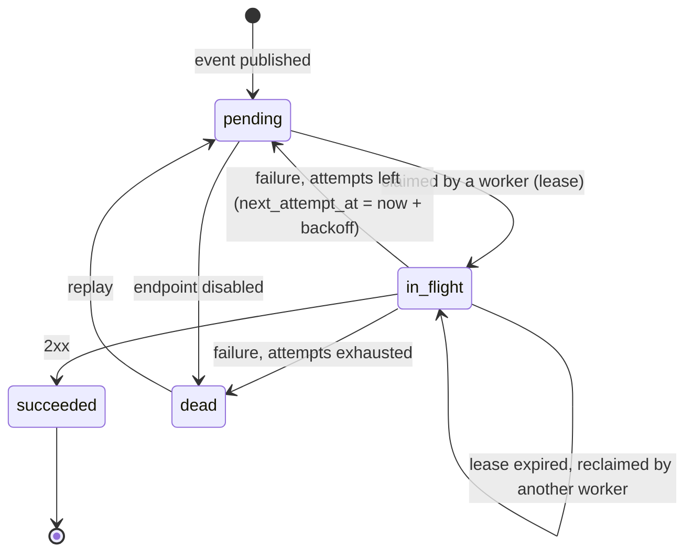

# Architecture

## Overview

Carteiro is a single Go binary with two roles, which can run in the same process or in
separate processes:

- **API**: authenticates producers, manages endpoints, and accepts events.
- **Worker**: claims due deliveries from PostgreSQL, sends them, and records the outcome.

PostgreSQL is the only stateful dependency. It stores the data *and* acts as the queue
([ADR 0001](adr/0001-postgres-as-queue.md)).



```
cmd/carteiro/          entrypoint: `serve`, `work`, `all`, `migrate`
internal/
  api/                 HTTP handlers, auth middleware, problem+json errors
  delivery/            worker loop, claiming, HTTP sender, backoff
  signing/             Standard Webhooks signing and verification
  netguard/            SSRF-safe dialer
  crypto/              AES-GCM for secrets at rest, API key generation and hashing
  store/               generated sqlc code + hand-written repository methods
  config/              environment configuration
migrations/            SQL migrations (embedded in the binary)
examples/receiver/     sample receiver verifying signatures with the official library
deploy/                docker compose, Prometheus and Grafana config
loadtest/              k6 scripts
```

## Data model



| Table | Key columns | Notes |
|---|---|---|
| `applications` | `id`, `name` | Tenant boundary. Every other row belongs to one. |
| `api_keys` | `prefix`, `hash`, `revoked_at` | `prefix` is shown in listings so a key can be identified without revealing it. |
| `endpoints` | `url`, `event_types text[]`, `status`, `consecutive_failures`, `failing_since` | `status` is `active` or `disabled`. |
| `endpoint_secrets` | `secret_ciphertext`, `expires_at` | Several rows during rotation; `expires_at` is null for the current secret. |
| `events` | `event_type`, `payload jsonb`, `idempotency_key`, `payload_hash` | `UNIQUE (application_id, idempotency_key)`. IDs are UUIDv7 so they sort by time. |
| `deliveries` | `status`, `attempt_count`, `next_attempt_at`, `lease_expires_at` | `UNIQUE (event_id, endpoint_id)`. This table is the queue. |
| `attempts` | `attempt_number`, `response_status`, `duration_ms`, `response_body`, `error` | Append-only log. |

Two partial indexes keep the queue queries cheap no matter how much history accumulates:

```sql
CREATE INDEX deliveries_due     ON deliveries (next_attempt_at)  WHERE status = 'pending';
CREATE INDEX deliveries_leased  ON deliveries (lease_expires_at) WHERE status = 'in_flight';
```

## Delivery lifecycle



### Claiming work

A worker claims a batch of due deliveries and marks them as leased in one short
statement ([ADR 0003](adr/0003-lease-based-claiming.md)):

```sql
WITH due AS (
    SELECT id FROM deliveries
    WHERE status = 'pending' AND next_attempt_at <= now()
    ORDER BY next_attempt_at
    LIMIT $1
    FOR UPDATE SKIP LOCKED
)
UPDATE deliveries d
SET status = 'in_flight',
    lease_expires_at = now() + $2::interval,
    attempt_count = d.attempt_count + 1
FROM due
WHERE d.id = due.id
RETURNING d.*;
```

The transaction commits immediately, *before* any HTTP call. A second, equivalent query
reclaims rows whose lease expired (`status = 'in_flight' AND lease_expires_at <= now()`),
which is how deliveries survive a worker crash.

### Recording the result

The outcome is written with `attempt_count` as a **fencing token**:

```sql
UPDATE deliveries SET status = $3, next_attempt_at = $4, lease_expires_at = NULL
WHERE id = $1 AND attempt_count = $2 AND status = 'in_flight';
```

If a slow worker finishes after its lease expired and another worker already reclaimed
the row, `attempt_count` no longer matches, the update affects zero rows, and the stale
result is discarded (its attempt is still logged). The receiver may have received the
event twice; that is the at-least-once contract ([ADR 0004](adr/0004-at-least-once-delivery.md)).

### Retry schedule

`delay(n) = min(cap, base × 2^(n-1))`, then *equal jitter*: the actual delay is a random
value in `[delay/2, delay]`. Jitter spreads retries out so that an endpoint recovering
from an outage is not hit by every queued delivery at the same instant; keeping the lower
half fixed guarantees a minimum wait.

Defaults: `base = 30s`, `cap = 6h`, `max_attempts = 12`, which covers roughly 15–20 hours
before a delivery is marked `dead`.

## Signing

Deliveries follow the [Standard Webhooks](https://www.standardwebhooks.com/) spec
([ADR 0002](adr/0002-standard-webhooks-signing.md)):

```
webhook-id:        <event id>
webhook-timestamp: <unix seconds>
webhook-signature: v1,<base64(HMAC-SHA256(secret, id + "." + timestamp + "." + body))>
```

During a rotation grace period, `webhook-signature` carries one signature per valid
secret, separated by spaces, so receivers can switch secrets without downtime.

## Outbound network safety

Receivers are URLs chosen by producers, so the worker must not become a way to reach
internal services (SSRF). The HTTP client uses a custom `net.Dialer` whose `Control`
hook inspects the **resolved IP at connect time** and refuses blocked ranges. Validating
only the hostname at endpoint creation is not enough: DNS can answer with a public IP
during validation and a private one during delivery (DNS rebinding).

Blocked by default: `127.0.0.0/8`, `::1`, `10.0.0.0/8`, `172.16.0.0/12`,
`192.168.0.0/16`, `169.254.0.0/16`, `fe80::/10`, `fc00::/7`, `100.64.0.0/10`,
`0.0.0.0/8`, `::`, multicast, and `255.255.255.255`. IPv6 addresses that embed an IPv4
address (IPv4-mapped `::ffff:a.b.c.d` and NAT64 `64:ff9b::/96`) are judged by the IPv4
address inside them, so an internal address cannot sneak through in IPv6 form. A
development flag allows private ranges so local receivers work.

## Observability

- Structured JSON logs with `log/slog`, with `event_id`, `delivery_id`, and `endpoint_id`
  on every delivery log line.
- Prometheus metrics:
  - `carteiro_deliveries_total{outcome}`
  - `carteiro_delivery_duration_seconds`
  - `carteiro_queue_depth`
  - `carteiro_oldest_pending_age_seconds`, the most useful alert signal, because it shows
    workers falling behind before anything fails.
- A Grafana dashboard in `deploy/` provisioned automatically by `docker compose`.

## Testing strategy

| Level | What | How |
|---|---|---|
| Unit | Backoff, signing (against the spec's test vectors), SSRF IP checks, idempotency conflict logic | `go test`, table-driven |
| Integration | Repository queries, claiming, fencing, migrations | Real PostgreSQL via Testcontainers |
| End-to-end | Publish → deliver → verify signature; receiver that fails N times then recovers | Carteiro in-process + `httptest` receiver |
| Concurrency | N workers draining the queue: every delivery succeeds, no row is claimed twice concurrently | Integration test with the race detector |
| Fault injection | Worker killed mid-delivery: the lease expires and the delivery still completes | Integration test |
| Load | Throughput and latency, published in the README | k6 |
